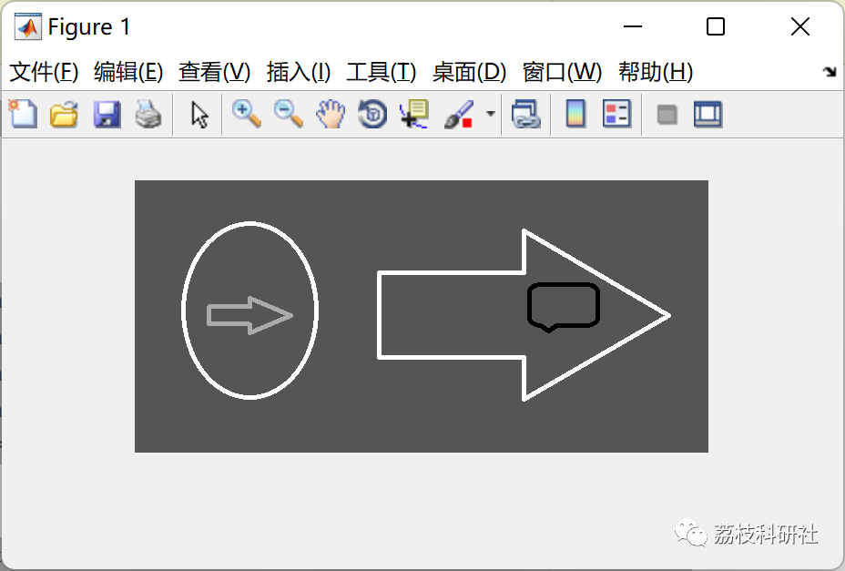

# Color image segmentation based on genetic algorithm (clustering) in Matlab code implementation

1. Image segmentation based on improved spectral clustering and genetic algorithm
Genetic algorithms, as an excellent global optimization method, have been widely applied in practice. However, there are some issues that need to be improved in practical applications: the lack of guarantee of converging to the global optimum solution, the loss of the best individual in the population, and premature convergence during the evolution process. In the field of image segmentation, genetic algorithms are commonly used to help determine segmentation thresholds, effectively solving the above problems.
This paper proposes an image segmentation method based on improved spectral clustering and genetic algorithm: according to the segmentation idea of regional consistency of image grayscale distribution, it first uses the improved spectral clustering method in pattern recognition to perform cluster segmentation with a specified threshold on the image; and through the calculation of fitness, evaluate and analyze the segmentation results corresponding to different specified thresholds; finally, fully utilize the excellent global search capability of genetic algorithms to adjust the threshold to achieve the optimal result.
Evolutionary clustering for image segmentation using genetic algorithm
Objective function: Within the cluster distance, use distance measurement
Measurement of image features: three features (R, G, B values)
It is also composed of matrix-based input sample examples with 15 and 2 features​.
2 MATLAB code implementation
clc;\nclear;\nclose all;\n​\n%% Problem Definition\nimg= double(imread('test.png'));\n[s1,s2,s3]=size(img);\nRplane = img(:,:,1);\nGplane = img(:,:,2);\nBplane = img(:,:,3);\nX1 = (Rplane-min(Rplane(:)))/(max(Rplane(:))-min(Rplane(:))); \nX2 = (Gplane-min(Gplane(:)))/(max(Gplane(:))-min(Gplane(:))); \nX3 = (Bplane-min(Bplane(:)))/(max(Bplane(:))-min(Bplane(:)));  \n% taking R-plane, B-plane, G-plane values as features\nX = [X1(:) X2(:) X3(:)]; % [(s1*s2)x3]\nk = 4; % no. of clusters\n​\nCostFunction=@(m) ClusteringCost2(m, X);     % Cost Function m = [3x2] cluster centers\n​\nVarSize=[k size(X,2)];  % Decision Variables Matrix Size = [4 3]\n​\nnVar=prod(VarSize);     % Number of Decision Variables = 12\n​\nVarMin= repmat(min(X),1,k);      % Lower Bound of Variables [4x1] of[1x3] = [4x3]\nVarMax= repmat(max(X),1,k);      % Upper Bound of Variables [4x1] of[1x3] = [4x3]\n​\n% Setting the Genetic Algorithms\n​\nga_opts = gaoptimset('display','iter','TimeLimit',600);\n  
Click the "Read More" button at the bottom left corner of this article.
Or reply with the keyword: Clustering-based color image segmentation using genetic algorithm.
3. Run results

## Images

<!-- PAYMENT_BLOCK -->

## Get this dataset

- Payment link (Stripe): [Buy now](https://buy.stripe.com/3cs8yP7sY87d0vu9AB)
- Payment QR code: 

<!-- /PAYMENT_BLOCK -->
